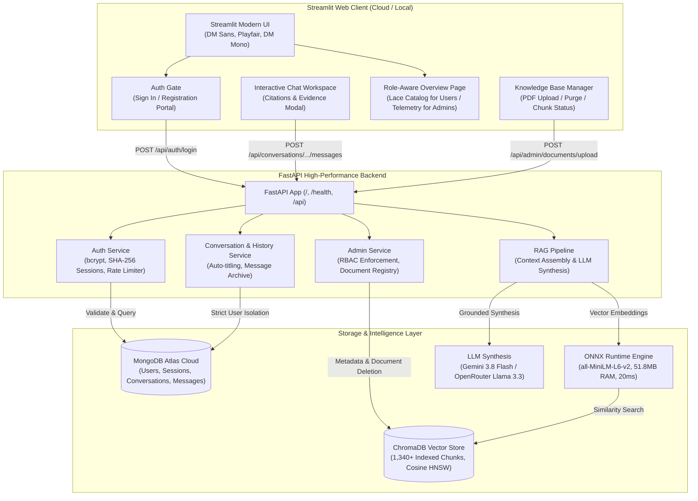

# 🧵 LabhTex Textile Intelligence — Grounded RAG Platform

A production-grade Retrieval-Augmented Generation (RAG) assistant designed for everyone navigating the textile and fashion landscape — from curious buyers, fashion designers, garment manufacturers, and students to textile engineers, quality control auditors, and plant managers. It enables anyone to explore industrial lace catalogs, inquire about fabric properties, and query authoritative technical documentation (ISO/ASTM test standards, warp-knitting machinery specs, yarn counts, and factory SOPs) with grounded, natural answers backed by transparent citations and verifiable evidence.

Built on a decoupled modern architecture combining a **FastAPI backend**, a **Streamlit frontend**, **MongoDB Atlas** for secure identity and chat persistence, **ChromaDB** for vector retrieval, an optimized **ONNX Runtime embedding engine**, and **Google Gemini / OpenRouter** for grounded synthesis.

<p align="center">
  
  
  
  
  
  
  
</p>

---

## 🏛️ System Architecture



---

## 🔐 Authentication, Authorization & User Experiences

The platform provides a secure, role-aware experience tailored to both regular users and technical administrators.

### 1. User Roles & Capabilities
| Role | Experience & Capabilities | Restrictions |
| :--- | :--- | :--- |
| **`user`** (Standard / Everyday User) | • **Lace Inquiries**: Ask natural questions about lace types, fabric properties, care, and garment design<br>• **Product Catalog**: Explore the classified Industrial Lace Catalog (Raschel, Guipure, Leavers, Stretch)<br>• **Evidence & Citations**: Inspect exact source documents and page numbers for full transparency<br>• **History**: Persistent, multi-device chat inquiry threads with auto-titling | • Cannot upload technical documents<br>• Cannot delete documents from vector store<br>• Blocked from administrative management endpoints (HTTP 403) |
| **`admin`** (Privileged Administrator) | • All standard user capabilities<br>• **Knowledge Base Portal**: Upload, inspect, and index technical PDF literature<br>• **Surgical Deletion**: Remove specific documents and chunks from ChromaDB<br>• **System Telemetry**: Real-time vector chunk counts, collection shares, and runtime specs | • Requires administrative registration key during signup |

### 2. Admin Provisioning
To register an Administrator account:
1. Open the **Auth Portal** and navigate to the **Register** tab.
2. Enter your Name, Email, and password ($\ge 12$ characters).
3. Expand the **Administrator Registration (Optional)** toggle.
4. Provide the private administrative key configured in the environment.
5. The backend validates the secret key against the environment configuration. If valid, the user is permanently assigned `role="admin"`. If invalid, the request is rejected with `HTTP 400 Bad Request`.

### 3. Security Architecture
- **Password Security**: Passwords hashed using `bcrypt` (12 salt rounds). Plaintext passwords are never logged or stored.
- **Session Protection**:
  - Cryptographically secure 32-byte tokens generated via `secrets.token_urlsafe(32)`.
  - **No raw tokens in database**: The backend hashes tokens using **SHA-256** before storing in MongoDB.
  - Set as `HttpOnly`, `SameSite=Lax`, and `Secure` cookies, plus Bearer token compatibility.
- **Session Expiry & Lifecycle**:
  - **30-minute sliding idle timeout**: Inactive sessions automatically expire.
  - **8-hour absolute maximum lifetime**: Re-authentication enforced regardless of activity.
  - **Immediate revocation on logout**: Deletes the session hash from MongoDB.
- **Brute-Force Rate Limiting**:
  - Sliding window rate-limiting tracks failed login attempts by IP and email.
  - Exceeding 5 consecutive failed attempts temporarily locks out authentication with `HTTP 429 Too Many Requests`.
- **Database Fallback Policy**: Strict MongoDB Atlas requirement. The system **never** falls back to SQLite, local files, or memory for user accounts or session tokens.

---

## ⚙️ Core Technical Pipeline

### 1. Ingestion (`src/ingestion.py`)
- Fast, high-fidelity PDF extraction via **PyMuPDF** (`fitz`).
- Retains document structure, page boundaries, and formatting headers.

### 2. Boundary-Aware Chunking (`src/chunking.py`)
- Window size: **500 characters** with **100-character overlap**.
- Natural break snapping (`\n\n`, `\n`, period, space) prevents cutting formulas or technical terms in half.
- Every chunk is stamped with its source filename, page number, and unique chunk index.

### 3. High-Efficiency ONNX Runtime Embeddings (`src/embeddings.py`)
- Powered by an optimized **ONNX Runtime engine** with tokenizers running `all-MiniLM-L6-v2`.
- **Ultra-Low Memory Footprint**: Uses only **~51.8MB of RAM** (down from 575MB with PyTorch), completely preventing out-of-memory errors on memory-constrained cloud environments (such as Render Free Tier's 512MB limit).
- **Fast CPU Inference**: ~20ms latency per query with exact mathematical parity (1.000000 cosine similarity) to standard PyTorch models.
- **Zero-Download Cold Start**: Pre-converted ONNX weights (`models/all-MiniLM-L6-v2/model.onnx`, 86MB) and `tokenizer.json` are committed directly to the repository, eliminating runtime Hugging Face downloads.

### 4. Vector Storage & Safe Deletion (`src/vector_store.py`)
- Persistent storage using **ChromaDB** with HNSW indexing (pre-indexed with 1,340+ verified chunks).
- **Document-Level Safe Deletion**: Deleting an indexed document queries chunks by `document_id` and surgically purges matching vectors without re-indexing the entire database.

### 5. Grounded Synthesis & Citations (`src/generation.py`, `src/citations.py`)
- Supports **Google Gemini** (`gemini-3.8-flash`) and **OpenRouter** (`meta-llama/llama-3.3-70b-instruct`).
- Credentials passed securely from user session or environment variables with a 30s timeout guardrail.
- Low temperature ($0.1$) for strict adherence to technical context.
- **Transparent Citations**: Answers automatically cite sources with interactive badges and a full raw evidence drawer.
- **Honest Abstention**: If the evidence is insufficient in the indexed knowledge base, the model explicitly abstains rather than hallucinating standards.

---

## 🎨 User Interface & Accessibility Highlights

- **Role-Aware Overview**:
  - Regular users enjoy an illustrated **Industrial Lace Catalog** covering Raschel & Jacquardtronic, Leavers & Chantilly, Chemical / Guipure, and High-Performance Stretch laces, complete with common fiber blends and garment application recommendations.
  - Administrators access live **Database Telemetry** (collection chunks, document shares, storage paths, and distance metrics).
- **High-Contrast Callout Banner**:
  - Engineered with dedicated `.callout-banner` styles ensuring pure white (`#ffffff`) serif headings and clear mint accents on deep forest green backgrounds, meeting high readability standards.
- **Natural, Lace-Centric Copy**:
  - Intuitive conversational copy ("Ask your query about laces") replacing robotic internal system phrases.

---

## 📁 Repository Structure

```text
Textile-RAG-Assistant/
├── backend/                               # FastAPI High-Performance Backend
│   ├── routes/
│   │   ├── admin.py                       # Document management & vector stats (RBAC protected)
│   │   ├── auth.py                        # Register, Login, Logout, Session Me
│   │   ├── conversations.py               # Conversation CRUD & isolation checks
│   │   └── messages.py                    # RAG synthesis & persistent chat messages
│   ├── config.py                          # Dynamic environment & secret loading
│   ├── database.py                        # MongoDB Atlas connection & index initialization
│   ├── main.py                            # FastAPI application entry, CORS middleware, GET/HEAD health
│   ├── models.py                          # Pydantic schemas and validation models
│   └── security.py                        # bcrypt, SHA-256 tokens, idle timeouts, rate limiter
├── models/                                # Optimized ONNX Inference Weights
│   └── all-MiniLM-L6-v2/
│       ├── model.onnx                     # Bundled ONNX model (86MB, 51.8MB RAM footprint)
│       ├── tokenizer.json                 # Fast HuggingFace tokenizer
│       └── special_tokens_map.json        # Tokenizer vocabulary configuration
├── src/                                   # RAG Pipeline & Client Modules
│   ├── api_client.py                      # Frontend HTTP client connecting Streamlit to FastAPI
│   ├── chunking.py                        # Sliding-window boundary-aware text chunker
│   ├── citations.py                       # Citation formatting and abstention detection
│   ├── embeddings.py                      # ONNX Runtime embedding engine (<60MB RAM)
│   ├── generation.py                      # LLM context assembly & answer generation
│   ├── ingestion.py                       # PyMuPDF page-aware PDF text extraction
│   ├── retrieval.py                       # Semantic search & similarity scoring
│   └── vector_store.py                    # ChromaDB persistent store & document deletion
├── lace_knowledge_base_deliverables/      # Curated Technical Literature
│   ├── Lace_Textile_Reference_Manual.pdf  # Comprehensive specifications (Yarns, machinery, tests)
│   ├── Lace_Industry_Operations_and_Commercial_Handbook.pdf # Production SOPs, formulas
│   └── Research_Bibliography.pdf          # Standards & citations
├── data/                                  # Persistent Storage
│   ├── chroma_db/                         # Permanent 1,340+ chunk vector store
│   ├── documents/                         # PDF document storage
│   └── documents_registry.json            # Document catalog
├── app.py                                 # Streamlit UI application with lace catalog & chat
├── requirements.txt                       # Production dependencies (ONNX Runtime, FastAPI, Streamlit)
├── run_local.bat                          # One-click Windows local runner
├── .env.example                           # Comprehensive environment configuration template
└── README.md                              # Technical documentation
```

---

## 🚀 Quick Start Guide

### 1. Prerequisites
- **Python 3.10+** (Tested on Python 3.10, 3.11, 3.12, 3.14)
- **MongoDB Atlas Cluster** ([Free M0 Sandbox](https://www.mongodb.com/cloud/atlas))
- An API Key for **Google Gemini** ([Google AI Studio](https://aistudio.google.com/)) or **OpenRouter** ([OpenRouter AI](https://openrouter.ai/keys))

### 2. Installation
```bash
# Clone the repository
git clone https://github.com/krushang15THECODER/Textile-RAG-Assistant.git
cd Textile-RAG-Assistant

# Create and activate a virtual environment
python -m venv .venv

# Windows (PowerShell):
.\.venv\Scripts\Activate.ps1

# Linux / macOS:
source .venv/bin/activate

# Install dependencies
pip install -r requirements.txt
```

### 3. Environment Setup
Copy the template file to `.env`:
```bash
cp .env.example .env
```
Fill in the configuration in `.env`:
```ini
# MongoDB Atlas
MONGODB_URI=<your_mongodb_connection_uri>
MONGODB_DB_NAME=labhtex_textile_rag

# Security
ADMIN_REGISTRATION_KEY=<your_chosen_admin_key>
SESSION_COOKIE_NAME=labhtex_session
BACKEND_URL=http://127.0.0.1:8000
CORS_ORIGINS=http://localhost:8501,http://127.0.0.1:8501,http://localhost:8000

# LLM Provider (Choose Gemini or OpenRouter)
# If using Gemini:
GEMINI_API_KEY=<your_gemini_api_key>
GEMINI_MODEL=gemini-3.8-flash

# If using OpenRouter:
OPENROUTER_API_KEY=<your_openrouter_api_key>
OPENROUTER_MODEL=meta-llama/llama-3.3-70b-instruct
```

### 4. Running Locally
You can launch both the backend and frontend together:

**Option A (Windows batch script):**
```cmd
run_local.bat
```

**Option B (Manual startup):**
```bash
# Terminal 1: Launch FastAPI Backend
uvicorn backend.main:app --host 127.0.0.1 --port 8000 --reload

# Terminal 2: Launch Streamlit Frontend
streamlit run app.py --server.port 8501
```

- **Frontend UI**: `http://localhost:8501`
- **Interactive API Docs (Swagger UI)**: `http://127.0.0.1:8000/docs`
- **Backend Health Check**: `http://127.0.0.1:8000/health`

---

## 🌐 Production Deployment Guide

The platform is designed for a dual-tier cloud deployment:
- **Backend**: Hosted as a Web Service on **Render** (or Railway/AWS/GCP).
- **Frontend**: Hosted on **Streamlit Community Cloud**.

### 1. Deploying the Backend on Render
1. Create a new **Web Service** on [Render](https://render.com/) and connect your GitHub repository.
2. Configure settings:
   - **Environment**: `Python`
   - **Build Command**: `pip install -r requirements.txt`
   - **Start Command**: `uvicorn backend.main:app --host 0.0.0.0 --port $PORT`
3. Add Environment Variables in Render:
   - `MONGODB_URI`: Your MongoDB Atlas connection string.
   - `MONGODB_DB_NAME`: `labhtex_textile_rag`
   - `ADMIN_REGISTRATION_KEY`: Your private admin registration key.
   - `OPENROUTER_API_KEY` (or `GEMINI_API_KEY`): Your LLM API key.
   - `CORS_ORIGINS`: Your deployed Streamlit URL (e.g. `https://<your-app>.streamlit.app`).
4. **Automated Ping Monitoring (Prevent Sleeping)**:
   - The backend supports `GET` and `HEAD` probes on `/` and `/health`.
   - Setup a monitor on [UptimeRobot](https://uptimerobot.com/) pointing to `https://<your-backend>.onrender.com/health` every 5-10 minutes.

### 2. Deploying the Frontend on Streamlit Cloud
1. Deploy your app on [Streamlit Community Cloud](https://share.streamlit.io/).
2. Set **Main file path**: `app.py`.
3. In **App Settings** $\rightarrow$ **Secrets**, configure:
   ```toml
   BACKEND_URL = "https://<your-render-service-name>.onrender.com"
   ```
   *(Ensure it uses `https://` with no trailing slash).*

---

## 🧪 Automated Test Suite

The codebase comes with a comprehensive suite of automated tests:

```bash
# 1. Test Authentication, Sessions, RBAC & Chat History
python test_auth_and_history.py

# 2. Test Boundary-Aware Chunking & Overlap Consistency
python test_chunking.py

# 3. Test High-Efficiency ONNX Embeddings Generation
python test_embeddings.py

# 4. Test ChromaDB Indexing, Idempotence & Safe Deletion
python test_vector_store.py

# 5. Test Semantic Retrieval & Similarity Scoring
python test_retrieval.py

# 6. Test Generation, Abstention Logic & Citations
python test_generation.py

# 7. Test PDF Ingestion
python test_ingestion.py
```

---

## 📋 API Endpoint Reference

| Method | Endpoint | Access | Description |
| :--- | :--- | :--- | :--- |
| `GET`, `HEAD` | `/` | Public | Service information and root availability check |
| `GET`, `HEAD` | `/health` | Public | System status, MongoDB ping, and ONNX engine check |
| `POST` | `/api/auth/register` | Public | User registration (admin with `admin_key`) |
| `POST` | `/api/auth/login` | Public | Authenticate user, issue session cookie & token |
| `POST` | `/api/auth/logout` | Authenticated | Revoke active session in MongoDB |
| `GET` | `/api/auth/me` | Authenticated | Inspect current user identity and role |
| `POST` | `/api/conversations` | Authenticated | Start a new inquiry thread |
| `GET` | `/api/conversations` | Authenticated | List all conversations for the user |
| `PATCH`| `/api/conversations/{id}` | Owner | Rename conversation inquiry title |
| `DELETE`| `/api/conversations/{id}` | Owner | Cascade delete conversation & all messages |
| `GET` | `/api/conversations/{id}/messages` | Owner | Retrieve message history with citations |
| `POST` | `/api/conversations/{id}/messages` | Owner | Query RAG pipeline & append answer |
| `GET` | `/api/admin/documents` | Admin Only | List all indexed PDFs & vector telemetry |
| `POST` | `/api/admin/documents/upload` | Admin Only | Ingest, chunk, and embed a new PDF |
| `DELETE`| `/api/admin/documents/{id}` | Admin Only | Surgical deletion of document vectors |
