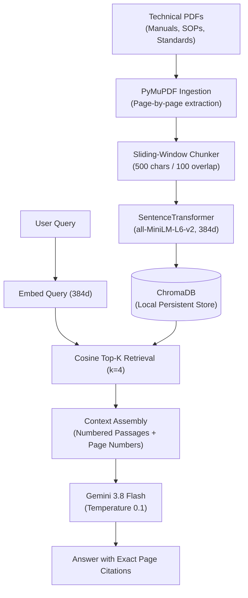

# Textile Intelligence — RAG Assistant

A retrieval-augmented generation (RAG) assistant built for textile engineers, quality control auditors, and plant managers. It lets users query technical documentation (ISO/ASTM test standards, warp-knitting machinery specs, wet processing recipes, and factory SOPs) and returns grounded answers with exact source document and page number citations.

<p align="center">
  
  
  
  
  
</p>

---

## Why this project?

Textile engineering and compliance testing are unforgiving with facts. If a technician needs to know the standard burst pressure limit for lace under **ISO 13938-2**, or the heat-setting temperature range for elastane to prevent fiber degradation, guessing or getting a hallucinated LLM answer can ruin fabric batches or fail factory audits.

Standard chatbots frequently make up ASTM test method numbers or fabricate recipes. This project enforces:
1. **Strict Context Grounding**: The LLM answers using *only* the retrieved text chunks from indexed PDFs. If the evidence isn't in the knowledge base, it explicitly says it doesn't know rather than making things up.
2. **Deterministic Citations**: Every answer provides clickable or traceable citations `[Document_Name.pdf, p. X]` with an expandable viewer showing the exact raw text chunks and similarity scores.
3. **Role Separation (RBAC)**:
   - **Customer**: A clean, distraction-free chat assistant with example prompt pills. Customers cannot upload or delete documents.
   - **Admin**: Authenticated interface to upload new technical PDFs, check live chunk counts, and safely delete individual documents without wiping the whole vector database.

---

## Architecture



---

## Features

- **Customer vs. Admin Portals**: Server-enforced role separation via `st.session_state.is_admin`. Customers cannot trigger admin routes or backend deletion calls.
- **Safe Document-Level Deletion**: Each uploaded document gets a unique `document_id`. Deleting a document purges only its matching chunks from ChromaDB using `where={"document_id": doc_id}` and removes the file from disk, leaving the rest of the database untouched.
- **Fast Local Embeddings**: Uses `all-MiniLM-L6-v2` locally on CPU. No recurring embedding API costs and no network latency on the vectorization step.
- **Pre-Loaded Knowledge Base**: Ingested with 84 pages of detailed textile literature:
  - `Lace_Textile_Reference_Manual.pdf` (60 pages covering machinery, yarns, dyeing, finishing, defects, and ISO/ASTM testing)
  - `Lace_Industry_Operations_and_Commercial_Handbook.pdf` (16 pages covering factory SOPs, yield formulas, and buyer compliance)
  - `Research_Bibliography.pdf` (8 pages listing standards, academic papers, and patents)

---

## Tech Stack

| Component | Choice | Reason |
| :--- | :--- | :--- |
| **PDF Extraction** | PyMuPDF (`pymupdf`) | Fast C-based text extraction with accurate page boundaries |
| **Chunking** | Custom sliding-window | 500 characters with 100 character overlap, preserving word boundaries |
| **Embeddings** | `all-MiniLM-L6-v2` | 384-dimensional dense vectors, runs locally on CPU with zero API cost |
| **Vector Database** | ChromaDB (`chromadb`) | Serverless local persistent storage using SQLite and HNSW indexing |
| **LLM Generation** | Google `gemini-3.8-flash` | Low latency, strong instruction following, low temperature ($0.1$) |
| **Web Interface** | Streamlit | Clean UI with session state management and custom CSS styling |

---

## Getting Started

### 1. Prerequisites
- Python 3.10 to 3.12 (or Python 3.14)
- A Google Gemini API key ([free from Google AI Studio](https://aistudio.google.com/))

### 2. Clone and Setup
```bash
# Clone the repository
git clone https://github.com/your-username/Textile-RAG-Assistant.git
cd Textile-RAG-Assistant

# Create and activate virtual environment
python -m venv .venv

# Windows:
.\.venv\Scripts\Activate.ps1

# Linux / macOS:
source .venv/bin/activate

# Install dependencies
pip install -r requirements.txt
```

### 3. Environment Variables
Create a `.env` file in the project root:
```ini
GEMINI_API_KEY=your_gemini_api_key_here
GEMINI_MODEL=gemini-3.8-flash
ADMIN_PASSWORD=admin123
```

### 4. Run the Application
```bash
streamlit run app.py
```
Open your browser at **`http://localhost:8501`**.

---

## How to Use

### Customer Mode (Default)
1. Open the app — you start in Customer Mode with access to the **AI Assistant** and the **Overview** telemetry dashboard. Knowledge base document uploads and deletions remain restricted to authenticated administrators.
2. Navigate between `01 / AI ASSISTANT` and `02 / OVERVIEW`.
3. In AI Assistant, click any of the quick prompt buttons or enter a technical question.
4. Read the synthesized response and inspect the citation badges.
5. Click **View Retrieved Evidence Chunks** to inspect the exact passage text, page numbers, and similarity percentages.

### Admin Mode
1. In the sidebar, expand **Admin Login**.
2. Enter the password (`admin123` or your value in `.env`).
3. The privileged **Knowledge Base** tab unlocks in navigation:
   - **Knowledge Base**: Upload any technical PDF. The system extracts the text, chunks it, embeds it, and updates the index. You can also view indexed documents and delete them with a confirmation dialog.
   - **Overview**: View live database statistics (total indexed PDFs, active vector count, collection name, and connection status).
4. Click **Log Out of Admin** to return to Customer Mode.

---

## Testing

Each component has a standalone test script:

```bash
# Test PDF extraction
python test_ingestion.py

# Test text chunking and overlap consistency
python test_chunking.py

# Test embedding generation
python test_embeddings.py

# Test ChromaDB indexing, queries, and document-level deletion
python test_vector_store.py

# Test semantic retrieval
python test_retrieval.py

# Test generation and citation formatting
python test_generation.py
```

---

## Project Structure

```text
Textile-RAG-Assistant/
├── app.py                             # Streamlit app (RBAC, chat interface, admin tabs)
├── requirements.txt                   # Project dependencies
├── .env.example                       # Environment template
├── README.md                          # Project documentation
├── src/                               # Core pipeline modules
│   ├── ingestion.py                   # PyMuPDF text extraction
│   ├── chunking.py                    # Boundary-aware text chunking
│   ├── embeddings.py                  # Local SentenceTransformer embedding wrapper
│   ├── vector_store.py                # ChromaDB manager (indexing & safe deletion)
│   ├── retrieval.py                   # Semantic search and context assembly
│   ├── generation.py                  # Gemini LLM response synthesis
│   └── citations.py                   # Citation parsing and abstention logic
├── data/                              # Local storage
│   ├── chroma_db/                     # Persistent ChromaDB vector store
│   ├── documents/                     # Uploaded PDF documents
│   └── documents_registry.json        # Document metadata catalog
├── lace_knowledge_base_deliverables/  # 84-page domain knowledge base
│   ├── Lace_Textile_Reference_Manual.pdf              # 60 pages
│   ├── Lace_Industry_Operations_and_Commercial_Handbook.pdf # 16 pages
│   └── Research_Bibliography.pdf                      # 8 pages
└── evaluation/                        # Evaluation scripts and test data
    ├── evaluate.py
    └── questions.json
```
