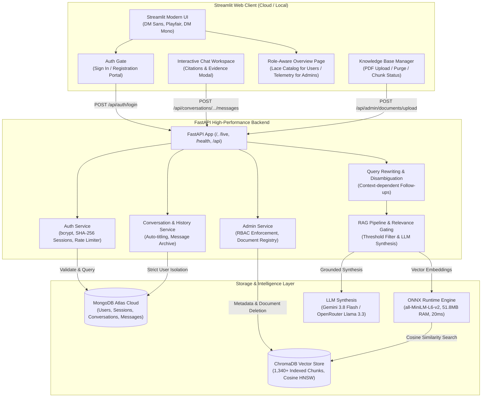

# 🧵 LabhTex Textile Intelligence — Grounded RAG Platform

A production-grade Retrieval-Augmented Generation (RAG) assistant designed for everyone navigating the textile and fashion landscape — from curious buyers, fashion designers, garment manufacturers, and students to textile engineers, quality control auditors, and plant managers. It enables anyone to explore industrial lace catalogs, inquire about fabric properties, and query authoritative technical documentation (ISO/ASTM test standards, warp-knitting machinery specs, yarn counts, and factory SOPs) with grounded, natural answers backed by transparent citations and verifiable evidence.

Built on a decoupled modern architecture combining a **FastAPI backend**, a **Streamlit frontend**, **MongoDB Atlas** for secure identity and chat persistence, **ChromaDB** for vector retrieval, an optimized **ONNX Runtime embedding engine**, conversational query rewriting for follow-ups, and **Google Gemini / OpenRouter** for grounded synthesis.

<p align="center">
  
  
  
  
  
  
  
</p>

---

## 🏛️ System Architecture



---

## 🔐 Authentication, Authorization & Security Configuration

The platform provides an enterprise-grade security model separating regular users from privileged administrators, complete with strict environment configuration validation.

### 1. Mandatory Admin Secret Configuration
- The backend **never** falls back to a hardcoded admin secret.
- `ADMIN_REGISTRATION_KEY` is loaded strictly from environment configuration.
- **Fail-Fast Startup Validation**: During application initialization (`lifespan`), the backend verifies that `ADMIN_REGISTRATION_KEY` is set and non-empty. If missing, startup fails immediately with a descriptive configuration error.
- Admin registration validates keys in constant time via `secrets.compare_digest` to prevent timing attacks.

### 2. Configurable Secure Cookies (`COOKIE_SECURE`)
- **HTTPS Production**: `COOKIE_SECURE=true` ensures session cookies are transmitted exclusively over encrypted HTTPS connections with `SameSite=None` (for cross-domain compatibility between Streamlit Cloud and Render) and `HttpOnly=True`.
- **Local Development**: `COOKIE_SECURE=false` allows HTTP testing without browser cookie rejections.
- **Strict Validation**: Rejects arbitrary or malformed strings; strictly parses `true`/`1`/`yes` and `false`/`0`/`no`. When unset, defaults intelligently to `True` if `BACKEND_URL` begins with `https://`.
- **Cookie Deletion**: Matching path, domain, secure, and samesite attributes are passed on logout to guarantee complete revocation.

### 3. User Roles & Capabilities
| Role | Experience & Capabilities | Restrictions |
| :--- | :--- | :--- |
| **`user`** (Standard / Everyday User) | • **Lace Inquiries**: Ask natural questions about lace types, fabric properties, care, and garment design<br>• **Follow-Up Questions**: Multi-turn dialogue with automatic query rewriting and reference resolution<br>• **Product Catalog**: Explore the classified Industrial Lace Catalog (Raschel, Guipure, Leavers, Stretch)<br>• **Evidence & Citations**: Inspect exact source documents and page numbers for full transparency<br>• **History**: Persistent, multi-device chat inquiry threads with auto-titling | • Cannot upload technical documents<br>• Cannot delete documents from vector store<br>• Blocked from administrative management endpoints (HTTP 403) |
| **`admin`** (Privileged Administrator) | • All standard user capabilities<br>• **Knowledge Base Portal**: Upload, inspect, and index technical PDF literature<br>• **Surgical Deletion**: Remove specific documents and chunks from ChromaDB<br>• **System Telemetry**: Real-time vector chunk counts, collection shares, and runtime specs | • Requires valid administrative registration key during signup |

---

## ⚙️ Core Technical Pipeline

### 1. Ingestion (`src/ingestion.py`)
- Fast, high-fidelity PDF extraction via **PyMuPDF** (`fitz`).
- Retains document structure, page boundaries, and formatting headers.

### 2. Boundary-Aware Chunking (`src/chunking.py`)
- Window size: **500 characters** with **100-character overlap**.
- Natural break snapping (`\n\n`, `\n`, period, space) prevents cutting formulas or technical terms in half.
- Every chunk is stamped with its source filename, page number, and unique chunk index.

### 3. High-Efficiency ONNX Runtime Embeddings (`src/embeddings.py`)
- Powered by an optimized **ONNX Runtime engine** with tokenizers running `all-MiniLM-L6-v2`.
- **Ultra-Low Memory Footprint**: Uses only **~51.8MB of RAM** (down from 575MB with PyTorch), completely preventing out-of-memory errors on memory-constrained cloud environments (such as Render Free Tier's 512MB limit).
- **Fast CPU Inference**: ~20ms latency per query with exact mathematical parity (1.000000 cosine similarity) to standard PyTorch models.
- **Zero-Download Cold Start**: Pre-converted ONNX weights (`models/all-MiniLM-L6-v2/model.onnx`, 86MB) and `tokenizer.json` are committed directly to the repository, eliminating runtime Hugging Face downloads.

### 4. Vector Storage & Safe Deletion (`src/vector_store.py`)
- Persistent storage using **ChromaDB** with HNSW indexing (pre-indexed with 1,340+ verified chunks).
- Cosine space (`hnsw:space: cosine`), where `distance = 1 - cosine_similarity` and `similarity = max(0.0, 1.0 - distance)`.

### 5. Configurable Relevance Thresholding & Abstention (`src/retrieval.py`)
- Configurable via `RETRIEVAL_SCORE_THRESHOLD` (default: `0.40`).
- **Benchmarked Metric**: Relevant textile questions consistently score between `0.53` and `0.81`, while out-of-domain queries (e.g., gas turbine efficiency or cryptocurrency) score below `0.35`.
- **Deterministic Abstention Guardrail**: If no retrieved passages meet the threshold, the system immediately returns an honest abstention response without invoking the LLM:
  > *"I couldn't find sufficient information in the available documents to answer this question."*
- Saves 100% of LLM token costs and prevents hallucinations on unsupported topics.

### 6. Conversational History & Follow-Up Query Rewriting (`src/generation.py`, `backend/routes/messages.py`)
- **Reference Resolution**: When a user asks a context-dependent question (e.g. *"What about its washing requirements?"* after discussing bridal lace), the rewriter automatically reconstructs an independent standalone retrieval query (e.g. *"Bridal lace washing and care requirements"*).
- **Preserved Intent**: Standalone technical inquiries (e.g. *"What is ASTM D3786 burst strength?"*) remain untouched to avoid unnecessary processing.
- **Strict Grounding**: Previous assistant conversational turns are used strictly to resolve entities, never as authoritative source documentation.

---

## 🎨 User Interface & Accessibility Highlights

- **Role-Aware Overview**:
  - Regular users enjoy an illustrated **Industrial Lace Catalog** covering Raschel & Jacquardtronic, Leavers & Chantilly, Chemical / Guipure, and High-Performance Stretch laces, complete with common fiber blends and garment application recommendations.
  - Administrators access live **Database Telemetry** (collection chunks, document shares, storage paths, and distance metrics).
- **High-Contrast Callout Banner**:
  - Engineered with dedicated `.callout-banner` styles ensuring pure white (`#ffffff`) serif headings and clear mint accents on deep forest green backgrounds, meeting high readability standards.
- **Cold-Start Resilience**:
  - Streamlit frontend includes fast bounded health checks and informative status cards so users understand Render cold-start wakeups (~45s) rather than seeing an indefinite spinner.

---

## 📁 Repository Structure

```text
Textile-RAG-Assistant/
├── backend/                               # FastAPI High-Performance Backend
│   ├── routes/
│   │   ├── admin.py                       # Document management & vector stats (RBAC protected)
│   │   ├── auth.py                        # Register, Login, Logout, Session Me
│   │   ├── conversations.py               # Conversation CRUD & isolation checks
│   │   └── messages.py                    # RAG synthesis, query rewriting & follow-up messages
│   ├── config.py                          # Environment validation, secrets, cookie security & thresholds
│   ├── database.py                        # MongoDB Atlas connection & index initialization
│   ├── main.py                            # FastAPI app, lifespan validation, CORS, /live & /health
│   ├── models.py                          # Pydantic schemas and validation models
│   └── security.py                        # bcrypt, SHA-256 tokens, idle timeouts, rate limiter
├── models/                                # Optimized ONNX Inference Weights
│   └── all-MiniLM-L6-v2/
│       ├── model.onnx                     # Bundled ONNX model (86MB, 51.8MB RAM footprint)
│       ├── tokenizer.json                 # Fast HuggingFace tokenizer
│       └── special_tokens_map.json        # Tokenizer vocabulary configuration
├── src/                                   # RAG Pipeline & Client Modules
│   ├── api_client.py                      # Frontend HTTP client connecting Streamlit to FastAPI
│   ├── chunking.py                        # Sliding-window boundary-aware text chunker
│   ├── citations.py                       # Citation formatting and abstention detection
│   ├── embeddings.py                      # ONNX Runtime embedding engine (<60MB RAM)
│   ├── generation.py                      # LLM context assembly, answer generation & query rewriting
│   ├── ingestion.py                       # PyMuPDF page-aware PDF text extraction
│   ├── retrieval.py                       # Semantic search & similarity threshold filtering
│   └── vector_store.py                    # ChromaDB persistent store & document deletion
├── lace_knowledge_base_deliverables/      # Curated Technical Literature
│   ├── Lace_Textile_Reference_Manual.pdf  # Comprehensive specifications (Yarns, machinery, tests)
│   ├── Lace_Industry_Operations_and_Commercial_Handbook.pdf # Production SOPs, formulas
│   └── Research_Bibliography.pdf          # Standards & citations
├── data/                                  # Persistent Storage
│   ├── chroma_db/                         # Permanent 1,340+ chunk vector store
│   ├── documents/                         # PDF document storage
│   └── documents_registry.json            # Document catalog
├── app.py                                 # Streamlit UI application with lace catalog & chat
├── requirements.txt                       # Production dependencies (ONNX Runtime, FastAPI, Streamlit)
├── run_local.bat                          # One-click Windows local runner
├── .env.example                           # Comprehensive environment configuration template
└── README.md                              # Technical documentation
```

---

## 🚀 Quick Start Guide

### 1. Prerequisites
- **Python 3.10+** (Tested on Python 3.10, 3.11, 3.12, 3.14)
- **MongoDB Atlas Cluster** ([Free M0 Sandbox](https://www.mongodb.com/cloud/atlas))
- An API Key for **Google Gemini** ([Google AI Studio](https://aistudio.google.com/)) or **OpenRouter** ([OpenRouter AI](https://openrouter.ai/keys))

### 2. Installation
```bash
# Clone the repository
git clone https://github.com/krushang15THECODER/Textile-RAG-Assistant.git
cd Textile-RAG-Assistant

# Create and activate a virtual environment
python -m venv .venv

# Windows (PowerShell):
.\.venv\Scripts\Activate.ps1

# Linux / macOS:
source .venv/bin/activate

# Install dependencies
pip install -r requirements.txt
```

### 3. Environment Setup
Copy the template file to `.env`:
```bash
cp .env.example .env
```
Fill in the configuration in `.env`:
```ini
# MongoDB Atlas
MONGODB_URI=<your_mongodb_connection_uri>
MONGODB_DB_NAME=labhtex_textile_rag

# Security (Mandatory: startup fails if ADMIN_REGISTRATION_KEY is missing)
ADMIN_REGISTRATION_KEY=<your_chosen_admin_key>
SESSION_COOKIE_NAME=labhtex_session
BACKEND_URL=http://127.0.0.1:8000
CORS_ORIGINS=http://localhost:8501,http://127.0.0.1:8501,http://localhost:8000

# Cookie Security ('false' for local HTTP development; 'true' for HTTPS production / Render)
COOKIE_SECURE=false

# Retrieval Threshold (0.0 to 1.0; questions scoring below this abstain cleanly)
RETRIEVAL_SCORE_THRESHOLD=0.40

# LLM Provider (Choose Gemini or OpenRouter)
# If using Gemini:
GEMINI_API_KEY=<your_gemini_api_key>
GEMINI_MODEL=gemini-3.8-flash

# If using OpenRouter:
OPENROUTER_API_KEY=<your_openrouter_api_key>
OPENROUTER_MODEL=meta-llama/llama-3.3-70b-instruct
```

### 4. Running Locally
You can launch both the backend and frontend together:

**Option A (Windows batch script):**
```cmd
run_local.bat
```

**Option B (Manual startup):**
```bash
# Terminal 1: Launch FastAPI Backend
uvicorn backend.main:app --host 127.0.0.1 --port 8000 --reload

# Terminal 2: Launch Streamlit Frontend
streamlit run app.py --server.port 8501
```

- **Frontend UI**: `http://localhost:8501`
- **Interactive API Docs (Swagger UI)**: `http://127.0.0.1:8000/docs`
- **Liveness Probe**: `http://127.0.0.1:8000/live`
- **Readiness / Health Check**: `http://127.0.0.1:8000/health`

---

## 🌐 Production Deployment Guide

The platform is designed for a dual-tier cloud deployment:
- **Backend**: Hosted as a Web Service on **Render** (or Railway/AWS/GCP).
- **Frontend**: Hosted on **Streamlit Community Cloud**.

### 1. Deploying the Backend on Render
1. Create a new **Web Service** on [Render](https://render.com/) and connect your GitHub repository.
2. Configure settings:
   - **Environment**: `Python`
   - **Build Command**: `pip install -r requirements.txt`
   - **Start Command**: `uvicorn backend.main:app --host 0.0.0.0 --port $PORT`
3. Add Environment Variables in Render:
   - `MONGODB_URI`: Your MongoDB Atlas connection string.
   - `MONGODB_DB_NAME`: `labhtex_textile_rag`
   - `ADMIN_REGISTRATION_KEY`: Your private admin registration key (required for startup).
   - `COOKIE_SECURE`: `true`
   - `RETRIEVAL_SCORE_THRESHOLD`: `0.40`
   - `OPENROUTER_API_KEY` (or `GEMINI_API_KEY`): Your LLM API key.
   - `CORS_ORIGINS`: Your deployed Streamlit URL (e.g. `https://<your-app>.streamlit.app`).
4. **Automated Ping Monitoring (Prevent Sleeping)**:
   - The backend supports `GET` and `HEAD` probes on `/` and `/health`.
   - Setup a monitor on [UptimeRobot](https://uptimerobot.com/) pointing to `https://<your-backend>.onrender.com/health` every 5-10 minutes.

### 2. Deploying the Frontend on Streamlit Cloud
1. Deploy your app on [Streamlit Community Cloud](https://share.streamlit.io/).
2. Set **Main file path**: `app.py`.
3. In **App Settings** $\rightarrow$ **Secrets**, configure:
   ```toml
   BACKEND_URL = "https://<your-render-service-name>.onrender.com"
   GEMINI_API_KEY = "AIzaSy..."
   ```
   *(Ensure `BACKEND_URL` uses `https://` with no trailing slash).*

---

## 🧪 Automated Test Suite

The codebase comes with a comprehensive suite of 51 passing automated tests:

```bash
# Run the entire test suite
python -m pytest -v

# 1. Test Authentication, Sessions, RBAC & Chat History (12 tests)
python -m pytest test_auth_and_history.py -v

# 2. Test Improvements, Secret Validation, Cookies, Follow-ups & Retrieval Thresholds (23 tests)
python -m pytest test_improvements_and_followup.py -v

# 3. Test Boundary-Aware Chunking & Overlap Consistency
python -m pytest test_chunking.py -v

# 4. Test High-Efficiency ONNX Embeddings Generation
python -m pytest test_embeddings.py -v

# 5. Test ChromaDB Indexing, Idempotence & Safe Deletion
python -m pytest test_vector_store.py -v

# 6. Test Semantic Retrieval & Similarity Scoring
python -m pytest test_retrieval.py -v

# 7. Test Generation, Abstention Logic & Citations
python -m pytest test_generation.py -v
```

---

## 📋 API Endpoint Reference

| Method | Endpoint | Access | Description |
| :--- | :--- | :--- | :--- |
| `GET`, `HEAD` | `/` | Public | Service information and root availability check |
| `GET`, `HEAD` | `/live` | Public | Fast liveness probe returning HTTP 200 `{"status": "alive"}` |
| `GET`, `HEAD` | `/health` | Public | Component readiness probe (database status, ONNX model readiness) |
| `POST` | `/api/auth/register` | Public | User registration (admin with validated `admin_key`) |
| `POST` | `/api/auth/login` | Public | Authenticate user, issue secure cookie & Bearer token |
| `POST` | `/api/auth/logout` | Authenticated | Revoke active session in MongoDB and clear cookie |
| `GET` | `/api/auth/me` | Authenticated | Inspect current user identity and role |
| `POST` | `/api/conversations` | Authenticated | Start a new inquiry thread |
| `GET` | `/api/conversations` | Authenticated | List all conversations for the authenticated user |
| `PATCH`| `/api/conversations/{id}` | Owner | Rename conversation inquiry title |
| `DELETE`| `/api/conversations/{id}` | Owner | Cascade delete conversation & all messages |
| `GET` | `/api/conversations/{id}/messages` | Owner | Retrieve message history chronologically with citations |
| `POST` | `/api/conversations/{id}/messages` | Owner | Query RAG pipeline with follow-up rewriting & thresholding |
| `GET` | `/api/admin/documents` | Admin Only | List all indexed PDFs & vector telemetry |
| `POST` | `/api/admin/documents/upload` | Admin Only | Ingest, chunk, and embed a new PDF |
| `DELETE`| `/api/admin/documents/{id}` | Admin Only | Surgical deletion of document vectors |
